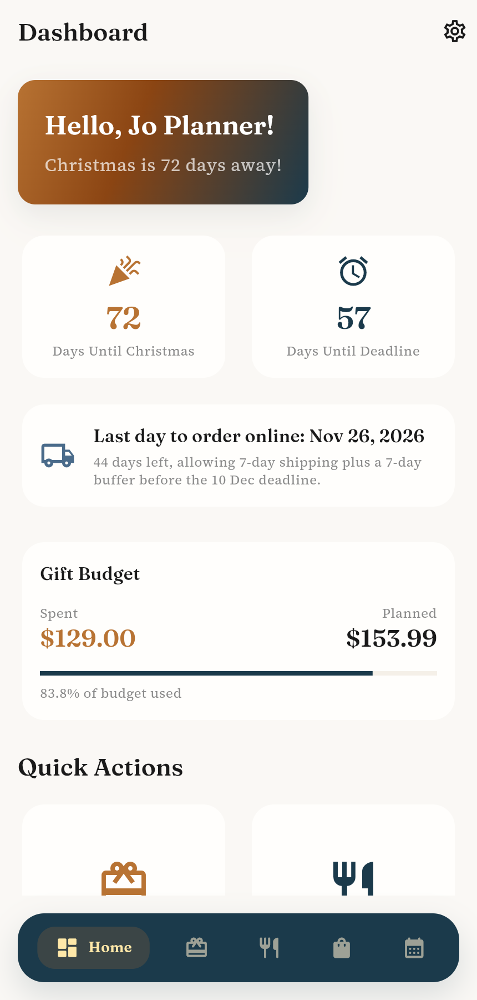
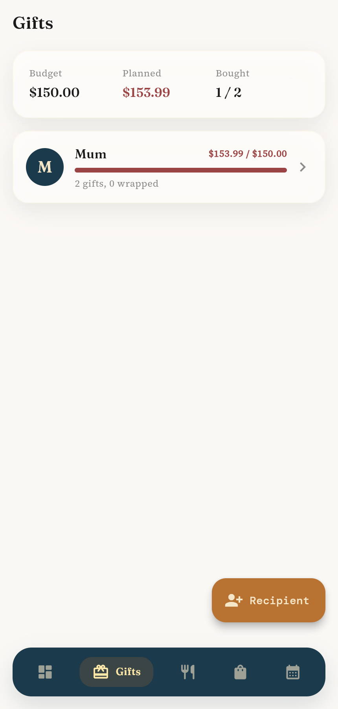
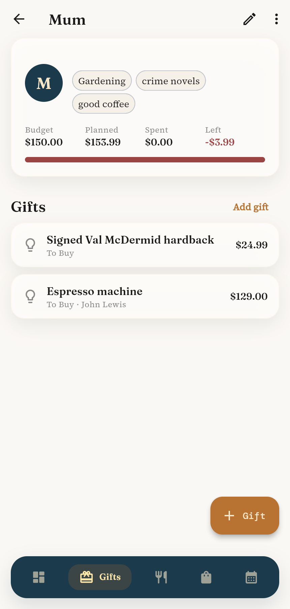
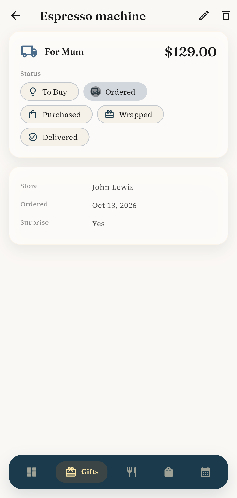
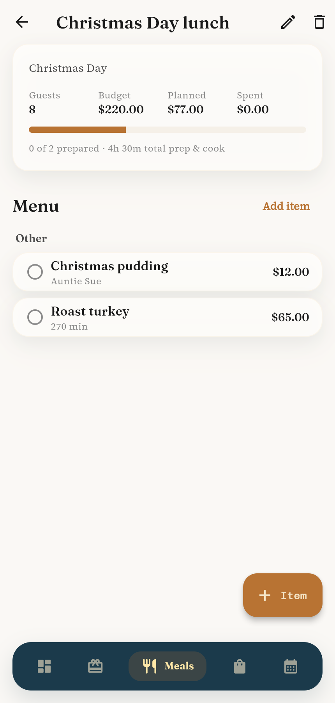
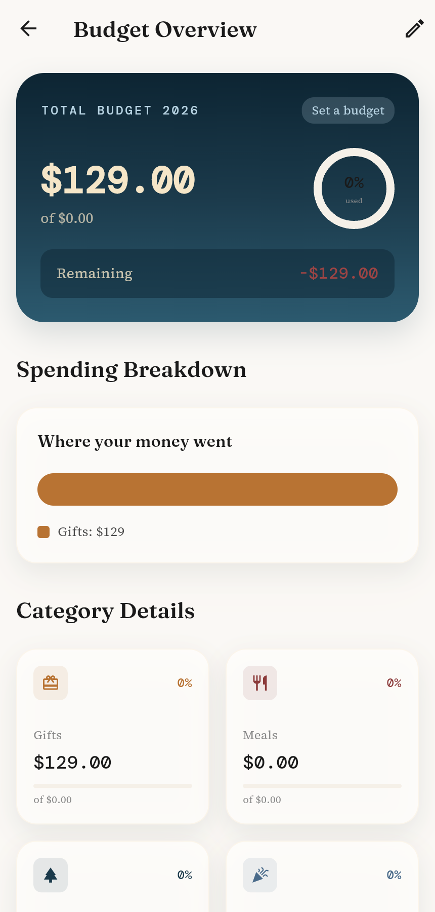

# Christmas Planner

Plan the whole Christmas in one place: who you are buying for and how much,
what you are cooking and what it costs, one budget that rolls it all up, and a
calendar that works back from 25 December.

Flutter web (mobile-capable) on a Supabase backend.
Product spec and current feature status: [docs/SPEC.md](docs/SPEC.md).

## Status

- Compiles, analyzer clean, tests pass, builds for web (see CI).
- Working today: accounts, recipients and gifts with status tracking and
  per-person budgets, meals with menus and costs, yearly budget overview,
  calendar events, shopping lists.
- Not built yet: last-order-date warnings, shopping list from a meal, manual
  expenses, household sharing. Full list in the spec.

## Screenshots

Taken by the browser smoke test (`tool/e2e/smoke.mjs`) against a local
Supabase stack, October 2026.

| Dashboard | Gifts | Recipient |
|---|---|---|
|  |  |  |

| Gift detail | Meal | Budget |
|---|---|---|
|  |  |  |

More in [docs/screenshots](docs/screenshots): login, recipient form, meals,
calendar, shopping, settings.

## Run it locally

Prerequisites: [Flutter](https://docs.flutter.dev/get-started/install)
(stable), [Docker](https://docs.docker.com/get-docker/), and the
[Supabase CLI](https://supabase.com/docs/guides/local-development).

```bash
# 1. Start the local Supabase stack (first run pulls ~3 GB of images)
supabase start
supabase status          # note "API URL" and "anon key"

# 2. Run the app against it
flutter pub get
flutter run -d chrome \
  --dart-define=SUPABASE_URL=http://127.0.0.1:54321 \
  --dart-define=SUPABASE_ANON_KEY=<anon key from supabase status>
```

The migrations in `supabase/migrations/` are applied automatically by
`supabase start`. Email confirmation is off in local config, so you can sign
up with any address and sign in immediately.

The values in `.env.example` are the standard local-development defaults and
are also compiled in as fallbacks for debug builds, so for local work the two
`--dart-define`s can be omitted.

## Hosted Supabase

1. Create a project at supabase.com.
2. Link and push the schema: `supabase link --project-ref <ref>` then
   `supabase db push`.
3. In Authentication settings, enable the Email provider.
4. Build with your project's URL and anon (publishable) key:

```bash
flutter build web --release \
  --dart-define=SUPABASE_URL=https://<ref>.supabase.co \
  --dart-define=SUPABASE_ANON_KEY=<anon key>
```

Deploy `build/web/` to any static host, or build the Docker image:

```bash
cp .env.example .env     # edit with the hosted values
docker compose up --build   # serves on http://localhost:8080
```

## Development

```bash
flutter analyze --fatal-infos
flutter test
dart format lib test
```

CI (`.github/workflows/ci.yml`) runs format, analyze, tests, a release web
build, and applies the SQL migrations to a fresh Postgres.

Browser smoke test (needs `supabase start`, a web build and Node):
`tool/e2e/smoke.mjs` signs up a fresh user, adds a recipient, gifts, a meal
and menu items through the real UI and screenshots every screen. The header
comment in the script has the exact commands.

Mobile: the project has no `android/` or `ios/` folders yet. Generate them
with `flutter create --platforms android,ios .` when you want device builds;
the Dart code is platform-neutral.

## Layout

```
lib/
  core/        constants, theme (Frosted Hearth design system), errors, utils, router
  features/    auth, dashboard, gifts, meals, budget, calendar, shopping, settings
               each with data/{models,repositories} and presentation/{providers,screens,widgets}
  shared/      models, services, widgets (FormSheet, Frosted* widgets, dialogs)
supabase/      config.toml, migrations/
docs/          SPEC.md
```

## License

MIT
