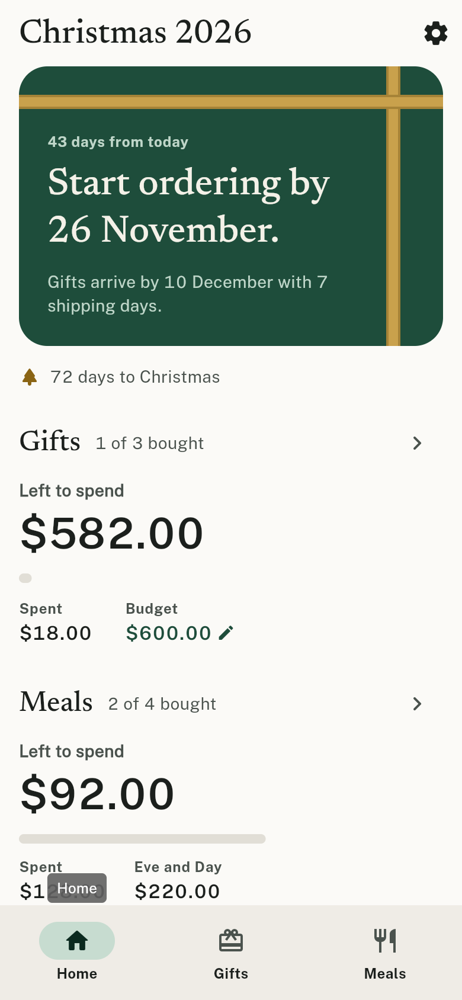
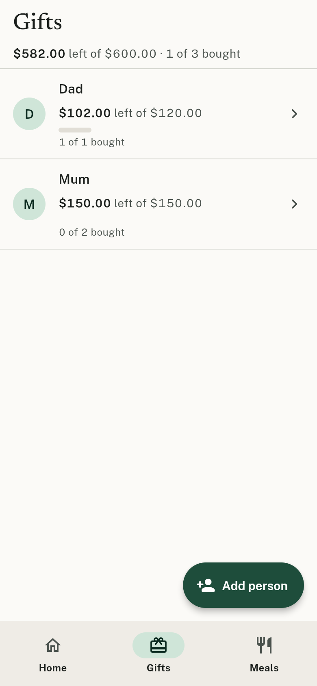
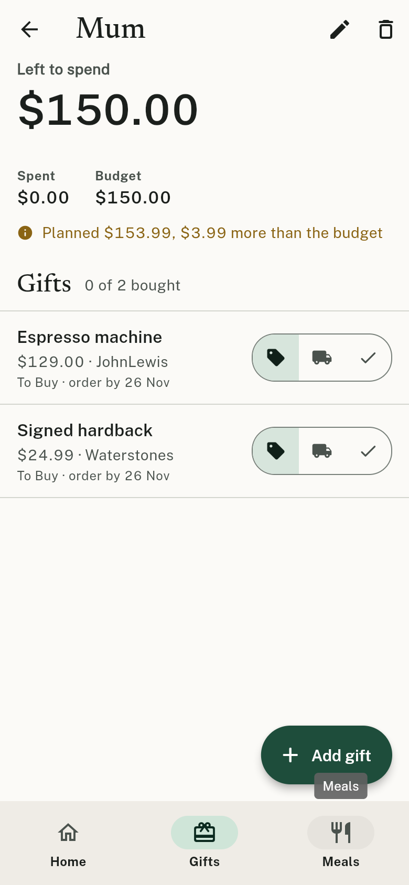
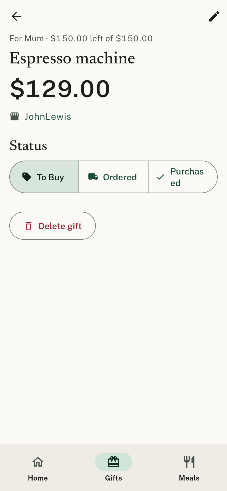
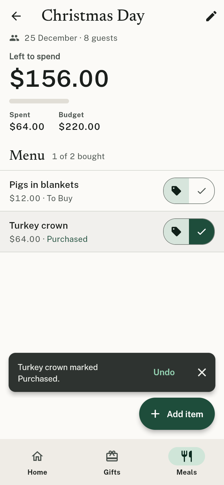
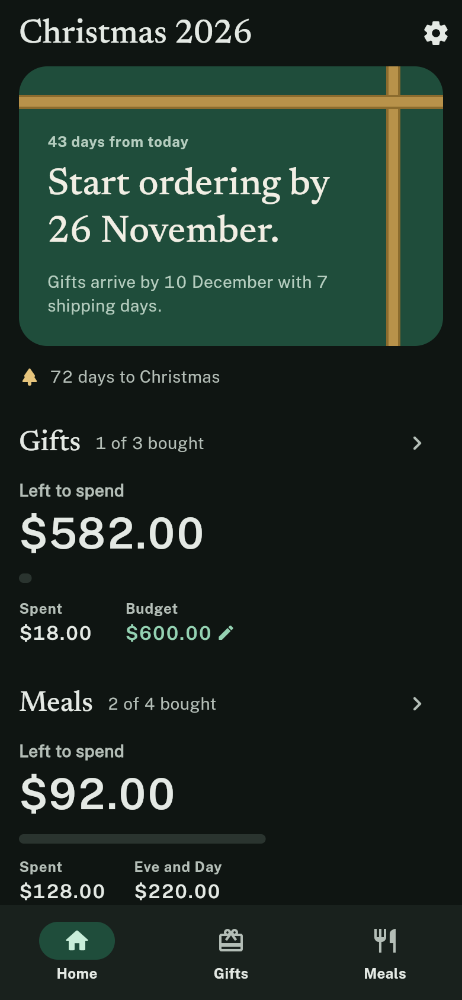
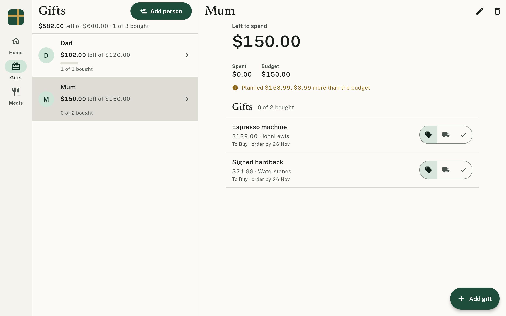

# Christmas Planner

Plan the whole Christmas in one place: who you are buying for and how much,
what you are cooking and what it costs, one budget that rolls it all up, and a
calendar that works back from 25 December.

Flutter web (mobile-capable) on a Supabase backend.
What it is and what it must do: [docs/PRD.md](docs/PRD.md). Technical design and
plan: [docs/superpowers](docs/superpowers). Design brief for the design session:
[docs/design](docs/design).

## Status

- Every requirement in `docs/PRD.md` is built and covered by a unit, widget
  or browser smoke test. Analyzer clean, 72 tests, CI green.
- Three tabs: Home (the ordering date, the two master budgets), Gifts
  (people, then one person's gifts), Meals (Christmas Eve and Christmas
  Day). Settings from Home. Previous years open read-only.
- Not hosted yet; web only (no `android/` or `ios/` folders).

## Screenshots

Taken by the browser smoke test (`make smoke`) against a local Supabase
stack, October 2026. Evergreen & Brass design, light theme unless noted.

| Home | Gifts | Recipient |
|---|---|---|
|  |  |  |

| Gift | Meal | Home, dark |
|---|---|---|
|  |  |  |

| Laptop: Gifts with a person selected |
|---|
|  |

All 22 in [docs/screenshots](docs/screenshots): sign in, create account, the
empty states, the forms, meals, settings and the laptop layouts.

## Run it locally

Prerequisites: [FVM](https://fvm.app) (Flutter Version Management),
[Docker](https://docs.docker.com/get-docker/), the
[Supabase CLI](https://supabase.com/docs/guides/local-development), and
Node (for the browser smoke test only).

The Flutter version is pinned per project in `.fvmrc`, so this repo can sit
on the newest Flutter it supports without touching other projects on the
same machine. CI reads the same file. All `make` targets call `fvm flutter`.

```bash
fvm install    # fetch the pinned Flutter SDK (once per version)
make db        # start the local Supabase stack (first run pulls ~3 GB of images)
make run       # fvm flutter run -d chrome against it
```

The local stack uses ports 56321-56329 instead of the CLI defaults (543xx)
so it can run beside other local Supabase projects. `make run` passes the
matching `--dart-define`s; to do it by hand:

```bash
fvm flutter run -d chrome \
  --dart-define=SUPABASE_URL=http://127.0.0.1:56321 \
  --dart-define=SUPABASE_ANON_KEY=<anon key from supabase status>
```

The migrations in `supabase/migrations/` are applied automatically by
`supabase start`. Email confirmation is off in local config, so you can sign
up with any address and sign in immediately.

The values in `.env.example` are the local-development defaults and are
also compiled in as fallbacks for debug builds, so for local work the two
`--dart-define`s can be omitted.

### Before you push

```bash
make check     # format, analyze, test, migrations lint: exactly what CI runs
make smoke     # release web build + browser smoke test, refreshes docs/screenshots
```

`make check` needs the local stack running for the migrations lint. Both
targets are expected to pass locally before a PR is opened; CI is a backstop,
not the first place a failure should show up.

## Hosted Supabase

1. Create a project at supabase.com.
2. Link and push the schema: `supabase link --project-ref <ref>` then
   `supabase db push`.
3. In Authentication settings, enable the Email provider.
4. Build with your project's URL and anon (publishable) key:

```bash
fvm flutter build web --release \
  --dart-define=SUPABASE_URL=https://<ref>.supabase.co \
  --dart-define=SUPABASE_ANON_KEY=<anon key>
```

Deploy `build/web/` to any static host, or build the Docker image:

```bash
cp .env.example .env     # edit with the hosted values
docker compose up --build   # serves on http://localhost:8080
```

## Development

`make check` is the gate (see above); the individual targets are `make
format`, `make analyze`, `make test`, `make lint-db`. Run `fvm dart format
lib test` to fix formatting rather than just report it. To move the project
to a newer Flutter: `fvm use <version>`, commit `.fvmrc` and `pubspec.lock`,
and CI follows.

CI (`.github/workflows/ci.yml`) runs the same format, analyze, tests, a
release web build, and applies the SQL migrations to a fresh Postgres.

Browser smoke test (`make smoke`): `tool/e2e/smoke.mjs` signs up a fresh
user, adds a recipient, gifts, a meal and menu items through the real UI and
screenshots every screen into `docs/screenshots`. Point it elsewhere with
`make smoke OUT_DIR=/some/dir`.

Mobile: the project has no `android/` or `ios/` folders yet. Generate them
with `fvm flutter create --platforms android,ios .` when you want device builds;
the Dart code is platform-neutral.

## Layout

```
lib/
  core/        constants, theme (Frosted Hearth design system), errors, utils, router
  features/    auth, dashboard, gifts, meals, budget, calendar, shopping, settings
               each with data/{models,repositories} and presentation/{providers,screens,widgets}
  shared/      models, services, widgets (FormSheet, Frosted* widgets, dialogs)
supabase/      config.toml, migrations/
docs/          PRD.md, original/ (PRD and TRD 1.0), superpowers/ (specs, plans),
               design/ (brief, output, decisions), screenshots/
```

## License

MIT
